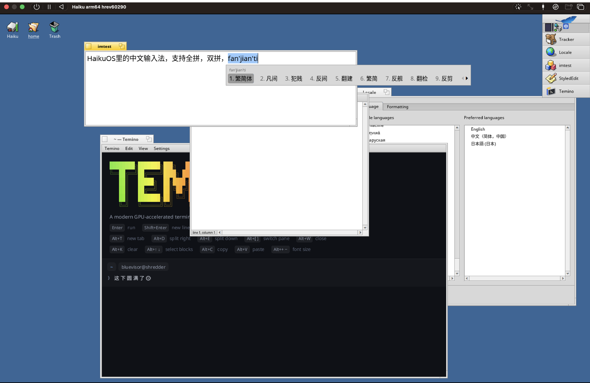

# 海酷拼音 Haiku Pinyin

A modern Chinese input method for Haiku, in the spirit of 搜狗拼音 and the
macOS pinyin input: whole-sentence conversion, abbreviations (`zgr` → 中国人,
`bjdx` → 北京大学), half-typed syllables, learning from what you pick, and
inline composition.



- **Full pinyin** and **shuangpin**: 拼音加加, 小鹤, 自然码, 微软, 智能ABC
- **简体 / 繁體** output
- **Sentences scored with word pairs** (a bigram model from libpinyin), with the
  last word you typed as context: `wozaixuexizhongwen` → 我在学习中文
- **联想**: after each commit, the words likely to come next (number keys pick)
- **模糊音**: z/zh c/ch s/sh, an/ang en/eng in/ing, n/l f/h r/l, each optional
- **中英混输**: `hello` also offers *hello*; nonsense pinyin offers English first
- Optional **cloud candidates** (Google Input Tools), off by default, marked ☁
- Emoji among the candidates: 太阳 → 🌞, 猫 → 🐱 (monochrome, via Noto Emoji)
- Full-width punctuation (`,` → `，`, `"` → `“”` or `「」`), left alone after digits
- Shift tap switches 中/英; Caps Lock types English
- Hover, the scroll wheel and the page arrows work in the candidate window;
  Ctrl+Delete forgets a word it learned
- Space or 1–9 pick, `-` `=` page, `[` `]` take the first/last character of a
  word (以词定字), Enter commits the letters, Backspace reopens the last pick
- Types inline in input-method-aware views (BTextView, Terminal) and plain
  text into everything else

## Install on Haiku

Download the package for your machine from the
[releases](https://github.com/bluevisor/haiku-pinyin/releases) (`arm64` or
`x86_64`; 32-bit Haiku's gcc2 input_server can't load it), copy it into
`~/config/packages`, then load it:

```sh
haiku_pinyin_restart      # restarts the input_server; keep Deskbar menus closed
```

(Logging out and in works too.) The candidate window needs a CJK font such
as Noto Sans CJK; for emoji, add Noto Emoji. App_server falls back to both
on its own.

To build it yourself instead, see Build below.

## Using it

Pick **海酷拼音** from the keyboard menu in Deskbar, or cycle input methods
with **Alt+Space**. With [Kigo](https://github.com/bluevisor/kigo), which
takes Alt+Space for itself, it's **Win+Space** (⌘+Space on a Mac keyboard).

| Key | |
|---|---|
| letters | pinyin (or shuangpin codes); the sentence is candidate 1 |
| Space, 1–9 | take the highlighted / numbered candidate |
| ← → ↑ ↓, `-` `=`, Page Up/Down | move the highlight, page |
| `[` `]` | just the first / last character of the candidate (以词定字) |
| Enter | type the letters as they are |
| Backspace | delete a letter; past a pick, reopen it |
| Escape | cancel |
| Ctrl+Delete | forget the highlighted word it learned from you |
| Shift (tap) | 中 / 英 |
| Caps Lock | English while it's on |

After a commit, 联想 shows likely next words: a number takes one, anything
else carries on as usual. Clicks, the scroll wheel and the page arrows work
in the candidate window.

The Deskbar menu holds the settings: 全拼 or a shuangpin layout, 简体 /
繁體, 全角标点, emoji, 联想, 中英混输, 云候选, the three 模糊音 groups,
and candidates per page. They're saved in `~/config/settings/HaikuPinyin`,
next to `user.dict`, the words it has learned (plain text).

Views that are input method aware (BTextView, so StyledEdit and most apps;
Terminal; [Temino](https://github.com/bluevisor/temino) 0.2.4+) show the
pinyin inline; everywhere else the committed text arrives as typing.

**Cloud candidates** send the pinyin of each composition, but nothing you've
committed, to Google Input Tools. They're off until you turn them on.

## Layout

| Path | What |
|---|---|
| `engine/` | Portable C++17 engine: lexicon, syllable graph (full pinyin, shuangpin, 模糊音), bigram beam-search decoder, 联想, user dictionary, S→T converter |
| `haiku/` | input_server method add-on and candidate window |
| `cli/hpcli.cpp` | Drive the engine from a terminal: `echo nihao \| build/hpcli --layout pyjj` |
| `tests/` | Engine tests |
| `tools/build_data.py` | Builds `build/data/` from `sources/` |
| `tools/haiku-testkeys/` | Dev only: a virtual keyboard device + `hpkeys` to type through the input_server over ssh, `imtest`, `hpsettings` |

## Build

```sh
tools/fetch_sources.sh      # rime-ice, libpinyin, OpenCC, rime-double-pinyin
make data test              # anywhere: data, engine, hpcli, tests
echo zgr | build/hpcli      # try it
haiku/sync.sh haiku-dbg     # copy to a Haiku machine and build there
# on Haiku:
make install                # add-on + data into ~/config/non-packaged
haiku/package.sh            # or: dist/haiku_pinyin-<v>-1-<arch>.hpkg
```

`haiku/cross.sh` cross-compiles the x86_64 add-on on a Mac (Haiku's
cross-compiler image in Docker) and packages it on a Haiku machine.

The input_server doesn't reload a replaced add-on, so run
`haiku/restart-input-server.sh` after each install, with no Deskbar menu open:
the new input_server waits on Deskbar, and an open menu deadlocks it (keyboard
and mouse stop until the script runs again over ssh).

## Data and licenses

Haiku Pinyin is GPL-3.0. Word frequencies come from
[雾凇拼音 rime-ice](https://github.com/iDvel/rime-ice) (GPL-3.0), simplified →
traditional tables from [OpenCC](https://github.com/BYVoid/OpenCC)
(Apache-2.0), word pairs from [libpinyin](https://github.com/libpinyin/libpinyin)'s
open-gram model (GPL-3.0, with Apache-2.0 parts), and shuangpin layouts from
the speller rules of
[rime-double-pinyin](https://github.com/rime/rime-double-pinyin) (LGPL-3.0).
