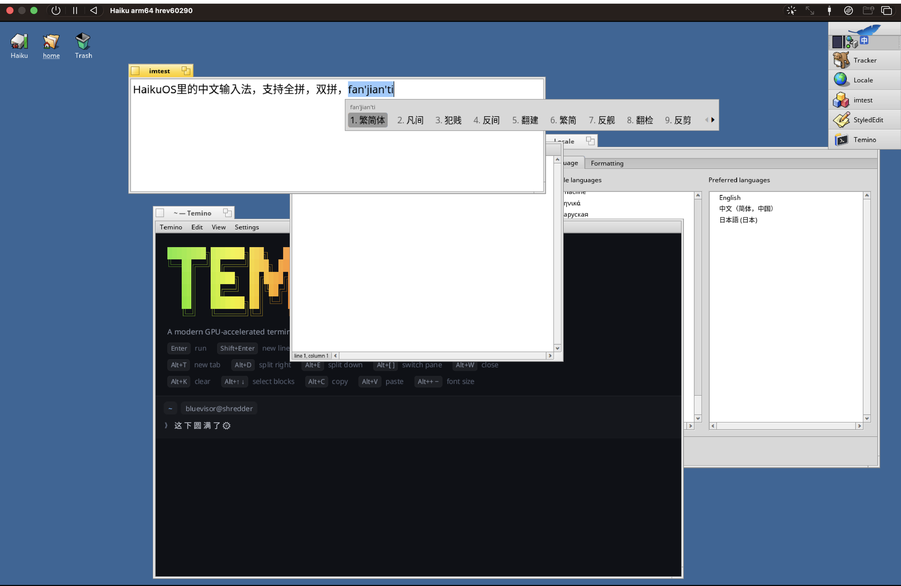

# 海酷拼音 Haiku Pinyin

A modern Chinese input method for Haiku (and Linux and macOS), in the spirit of 搜狗拼音 and the
macOS pinyin input: whole-sentence conversion, abbreviations (`zgr` → 中国人,
`bjdx` → 北京大学), half-typed syllables, learning from what you pick, and
inline composition.



- **Full pinyin** and **shuangpin**: 拼音加加, 小鹤, 自然码, 微软, 智能ABC
- **简体 / 繁體** output
- **Sentences scored with word pairs** (a bigram model from libpinyin), with the
  last word you typed as context: `wozaixuexizhongwen` → 我在学习中文
- **AI** (macOS, Apple silicon): a small language model on the Mac reads the
  text before the cursor, moves the candidate that reads best first (✦), and
  after a commit offers what likely comes next, taken with Tab
- **模糊音**: z/zh c/ch s/sh, an/ang en/eng in/ing, n/l f/h r/l, each optional
- **中英混输**: `hello` also offers *hello*; nonsense pinyin offers English first
- Optional **cloud candidates** (Google Input Tools), off by default, marked ☁
- Emoji among the candidates: 太阳 → 🌞, 猫 → 🐱 (monochrome, via Noto Emoji)
- Full-width punctuation (`,` → `，`, `"` → `“”` or `「」`), left alone after digits
- Shift tap switches 中/英; Caps Lock types English
- Hover, the scroll wheel and the page arrows work in the candidate window;
  Ctrl+Delete forgets a word it learned
- Space or 1–9 pick, `-` `=` page, `[` `]` take the first/last character of a
  word (以词定字), Enter commits the letters, Backspace reopens the last pick
- Types inline in input-method-aware views (BTextView, Terminal) and plain
  text into everything else

## Install on Haiku

Download the package for your machine from the
[releases](https://github.com/bluevisor/haiku-pinyin/releases) (`arm64` or
`x86_64`; 32-bit Haiku's gcc2 input_server can't load it), copy it into
`~/config/packages`, then load it:

```sh
haiku_pinyin_restart      # restarts the input_server; keep Deskbar menus closed
```

(Logging out and in works too.) The candidate window needs a CJK font such
as Noto Sans CJK; for emoji, add Noto Emoji. App_server falls back to both
on its own.

To build it yourself instead, see Build below.

## Install on Linux

On Linux it's an [IBus](https://github.com/ibus/ibus) engine (GNOME,
and anywhere else IBus runs). Build it with the IBus headers:

```sh
sudo apt install build-essential libibus-1.0-dev curl python3   # Debian/Ubuntu
tools/fetch_sources.sh && make data ibus
sudo make install-ibus && linux/enable.sh  # into /usr, where IBus looks
# or, without root (GNOME, or another systemd user session):
linux/install-user.sh                      # into ~/.local; --remove undoes it
```

`linux/enable.sh` restarts IBus and adds **海酷拼音 Haiku Pinyin** to
GNOME's input sources (or add it under Settings → Keyboard → Input Sources →
Chinese); switch with Super+Space. On GNOME, don't use `ibus restart`: the
daemon runs as a systemd user unit and stays stopped. Restart it with
`systemctl --user restart org.freedesktop.IBus.session.GNOME.service`. Apps
started outside the desktop session need `GTK_IM_MODULE=ibus` to reach it. Everything in Using it
below applies, except that the settings live in the input source menu in the
top bar, and are saved in `~/.config/haiku-pinyin/` with `user.dict`.

## Install on macOS

On a Mac it's an InputMethodKit input method (macOS 13 or later, Apple
silicon or Intel). Build it with Xcode's command line tools:

```sh
tools/fetch_sources.sh && make data install-mac   # into ~/Library/Input Methods
```

Then add it yourself, as macOS asks: System Settings → Keyboard → Input
Sources → Edit… → **+** → Chinese, Simplified → **Haiku Pinyin**, and switch
to it with Control+Space or 🌐. The candidates show in the system's own
candidate window. A Shift tap switches 中/英, with a 中 or 英 by the text to
say which; **设置…** in the input menu opens the settings window. Control-Delete
forgets a learned word. What it learns is in
`~/Library/Application Support/HaikuPinyin/user.dict`; `macos/install.sh
--remove` uninstalls it.

**AI** needs Apple silicon and a model: `macos/ai/fetch-models.sh` converts
Qwen3-1.7B-Base and Qwen3.5-0.8B-Base to 4-bit MLX (about 1.4 GB) into
`~/Library/Application Support/HaikuPinyin/models`, or links copies you have
(`fetch-models.sh <directory>`). A helper process holds the model (about
1 GB of memory while AI is on) and answers on the side, like the cloud: typing
never waits for it. The settings window turns AI picks and completions on or
off and chooses the model: 自动 uses the 1.7B and falls back to the 0.8B on a
Mac too slow for it; any MLX model in that folder can be chosen. Nothing you
type leaves the Mac. `NO_AI=1 macos/build.sh` builds without the helper.

## Using it

Pick **海酷拼音** from the keyboard menu in Deskbar, or cycle input methods
with **Alt+Space**. With [Kigo](https://github.com/bluevisor/kigo), which
takes Alt+Space for itself, it's **Win+Space** (⌘+Space on a Mac keyboard).

| Key | |
|---|---|
| letters | pinyin (or shuangpin codes); the sentence is candidate 1 |
| Space, 1–9 | take the highlighted / numbered candidate |
| ← → ↑ ↓, `-` `=`, Page Up/Down | move the highlight, page |
| `[` `]` | just the first / last character of the candidate (以词定字) |
| Enter | type the letters as they are |
| Backspace | delete a letter; past a pick, reopen it |
| Escape | cancel |
| Ctrl+Delete | forget the highlighted word it learned from you |
| Shift (tap) | 中 / 英 |
| Caps Lock | English while it's on |

Clicks, the scroll wheel and the page arrows work in the candidate window.

The Deskbar menu holds the settings: 全拼 or a shuangpin layout, how
shuangpin spells a, o and e (aa oo ee, oa oo oe, or one key each), 简体 /
繁體, 全角标点, emoji, 中英混输, 云候选, the three 模糊音 groups,
and candidates per page. They're saved in `~/config/settings/HaikuPinyin`,
next to `user.dict`, the words it has learned (plain text).

Views that are input method aware (BTextView, so StyledEdit and most apps;
Terminal; [Temino](https://github.com/bluevisor/temino) 0.2.4+) show the
pinyin inline; everywhere else the committed text arrives as typing.

**Cloud candidates** send the pinyin of each composition, but nothing you've
committed, to Google Input Tools. They're off until you turn them on.

## Layout

| Path | What |
|---|---|
| `engine/` | Portable C++17 engine: lexicon, syllable graph (full pinyin, shuangpin, 模糊音), bigram beam-search decoder, user dictionary, S→T converter; the questions and answers for cloud and AI candidates |
| `haiku/` | input_server method add-on and candidate window |
| `macos/` | InputMethodKit method (`InputController.mm`), AI helper client (`AI.mm`) and the helper itself (`ai/`, Swift + MLX), settings window and 中/英 bubble (`Settings.swift`), `build.sh`, `install.sh`; dev only: `test-session.sh` types through it in a test window (full pinyin, shuangpin, then AI when its models are installed), `snapshot-settings.swift` renders the settings window and bubble to PNG |
| `linux/` | IBus engine (`main.cpp`), component file, installers (`enable.sh`, `install-user.sh`); dev only: `sync.sh` builds on a Linux box over ssh, `test-session.sh` types through gedit with xdotool |
| `cli/hpcli.cpp` | Drive the engine from a terminal: `echo nihao \| build/hpcli --layout pyjj` |
| `tests/` | Engine tests |
| `tools/build_data.py` | Builds `build/data/` from `sources/` |
| `tools/haiku-testkeys/` | Dev only: a virtual keyboard device + `hpkeys` to type through the input_server over ssh, `imtest`, `hpsettings` |

## Build

```sh
tools/fetch_sources.sh      # rime-ice, libpinyin, OpenCC, rime-double-pinyin
make data test              # anywhere: data, engine, hpcli, tests
echo zgr | build/hpcli      # try it
haiku/sync.sh haiku-dbg     # copy to a Haiku machine and build there
# on Haiku:
make install                # add-on + data into ~/config/non-packaged
haiku/package.sh            # or: dist/haiku_pinyin-<v>-1-<arch>.hpkg
```

`haiku/cross.sh` cross-compiles the x86_64 add-on on a Mac (Haiku's
cross-compiler image in Docker) and packages it on a Haiku machine.

The input_server doesn't reload a replaced add-on, so run
`haiku/restart-input-server.sh` after each install, with no Deskbar menu open:
the new input_server waits on Deskbar, and an open menu deadlocks it (keyboard
and mouse stop until the script runs again over ssh).

## Data and licenses

Haiku Pinyin is GPL-3.0. Word frequencies come from
[雾凇拼音 rime-ice](https://github.com/iDvel/rime-ice) (GPL-3.0), simplified →
traditional tables from [OpenCC](https://github.com/BYVoid/OpenCC)
(Apache-2.0), the AI's models from [Qwen](https://huggingface.co/Qwen)
(Apache-2.0, downloaded separately) run with
[MLX](https://github.com/ml-explore/mlx-swift) (MIT), word pairs from [libpinyin](https://github.com/libpinyin/libpinyin)'s
open-gram model (GPL-3.0, with Apache-2.0 parts), and shuangpin layouts from
the speller rules of
[rime-double-pinyin](https://github.com/rime/rime-double-pinyin) (LGPL-3.0).
