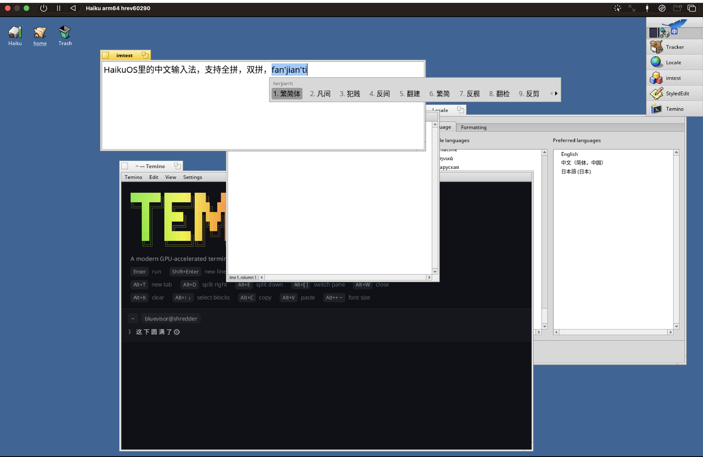

# 海酷拼音 Haiku Pinyin

[English](README.md) · **简体中文** · [繁體中文](README.zh-TW.md) ·
[下载页](https://bluevisor.github.io/haiku-pinyin/) · [隐私](#隐私) ·
[安全](SECURITY.md) · [参与开发](CONTRIBUTING.md)

一款给 macOS、Linux 和 Haiku 用的拼音输入法，手感向搜狗拼音和 macOS
自带拼音看齐：整句输入、简拼（`zgr` → 中国人，`bjdx` → 北京大学）、
输到一半的音节也能出字、按你的选择自动调频、输入时直接在文中显示拼音。
同一个引擎，三个平台各有原生的前端。

在 Apple 芯片的 Mac 上，它还能用**本机运行的 AI 模型**帮你选词、
补全下文；**默认不联网**，你打的字不会离开你的电脑。



| | 下载 | 形式 | 独有功能 |
|---|---|---|---|
| **macOS** 13+ | [`.pkg` 或 `.dmg`](https://github.com/bluevisor/haiku-pinyin/releases/latest)，已签名并经 Apple 公证 | InputMethodKit 输入法 | 本机 AI 选词和灰色补全（Apple 芯片）、自动更新、设置窗口 |
| **Linux** | arm64 / amd64 的 [`.deb`](https://github.com/bluevisor/haiku-pinyin/releases/latest)（Ubuntu 22.04+、Debian 12+），之后用 `apt` 签名更新；Arch 的 `PKGBUILD`、Fedora 的 `.spec`；也可以从源码构建 | IBus 引擎（GNOME 等）或 Fcitx5 插件（KDE Plasma 等） | 设置窗口（IBus、GNOME 设置；Fcitx5 也能用）、顶栏输入法菜单或 Fcitx5 配置工具 |
| **Haiku**（64 位） | arm64 / x86_64 的 [`.hpkg`](https://github.com/bluevisor/haiku-pinyin/releases/latest)，附签名校验和 | input_server 插件 | Deskbar 菜单，在 BTextView 和 Terminal 里内嵌输入 |

## 安装

### macOS

需要 macOS 13 或更新版本，Apple 芯片和 Intel 都可以。

1. 从 [Releases](https://github.com/bluevisor/haiku-pinyin/releases/latest)
   下载 `HaikuPinyin-<版本>.pkg`，双击打开。
2. 安装器会把它装进 `~/Library/Input Methods`，只给当前用户装，
   **不需要管理员密码**，装好后自动加进输入法菜单并切换过去。

也可以下载 `HaikuPinyin-<版本>.dmg`，打开后运行 **HaikuPinyin**，
它会自己装好。如果 macOS 要求手动添加，它会提示并打开对应位置：
系统设置 › 键盘 › 输入法 › 编辑… › **+** › 简体中文 › **海酷拼音**。

用 Control+空格 或 🌐 键切换到海酷拼音。安装包用 Developer ID
签名并经过 Apple 公证。它会**自动更新**：每天查一次新版本，校验下载文件的签名，
在 Mac 空闲时替换（设置里关掉**自动更新**即可停用，**检查更新…**可以立即检查）。

**AI**（仅 Apple 芯片）：在设置窗口点**下载模型**，从 Hugging Face
（连不上时用 hf-mirror.com 镜像）下载 Qwen3-1.7B-Base 和 Qwen3.5-0.8B-Base
的 4 位 MLX 版本，共约 1.4 GB，存到
`~/Library/Application Support/HaikuPinyin/models`，每个文件都会校验。
下载中断了会从断点续传。还没下载模型时，打完一个词停顿一下，
文字下方会出现一张小卡片提示一次，它不会抢走键盘焦点。
模型由一个辅助进程加载（开启 AI 时约占 1 GB 内存），
在旁边给出建议，打字从不等它。设置里可以分别开关 **AI 选词**和
**AI 补全**，并选择模型：**自动**优先用 1.7B，在太慢的 Mac 上换成 0.8B；
放进那个文件夹的任何 MLX 模型都能选。

### Linux

两种输入法框架都支持：[IBus](https://github.com/ibus/ibus)（GNOME 等）和
[Fcitx5](https://github.com/fcitx/fcitx5)（KDE Plasma 等）。两者是同一个引擎，
设置和学到的词都存在 `~/.config/haiku-pinyin/`（`settings`、`user.dict`），
换框架也不会丢。

**Debian、Ubuntu**（Ubuntu 22.04+、Debian 12+）：从
[Releases](https://github.com/bluevisor/haiku-pinyin/releases) 下载
`haiku-pinyin-data_<版本>_all.deb`，再按你用的框架下载
`haiku-pinyin_<版本>_<架构>.deb`（IBus）或
`fcitx5-haiku-pinyin_<版本>_<架构>.deb`（Fcitx5），架构是 `arm64` 或 `amd64`：

```sh
# IBus
sudo apt install ./haiku-pinyin-data_*.deb ./haiku-pinyin_*.deb
haiku-pinyin-enable        # 用你自己的账户运行：重启 IBus，加进 GNOME
# Fcitx5
sudo apt install ./haiku-pinyin-data_*.deb ./fcitx5-haiku-pinyin_*.deb
fcitx5 -rd                 # 用你自己的账户运行：重启 Fcitx5
```

`haiku-pinyin-data` 会添加本项目的 apt 软件源和发布密钥
（`/etc/apt/sources.list.d/haiku-pinyin.sources`、
`/usr/share/keyrings/haiku-pinyin-archive-keyring.gpg`），之后
`sudo apt update && sudo apt upgrade` 就能升级到新版本，
没有用这把密钥签名的包 apt 会拒绝。软件源就是 GitHub 上的最新 Release；
配好以后也可以直接 `sudo apt install fcitx5-haiku-pinyin`（或 `haiku-pinyin`）。

**Arch**：`make linux-arch` 在 `dist/arch/` 生成可以直接提交到 AUR 的
`PKGBUILD`，从 Release 的源码包和数据包构建 `ibus-haiku-pinyin`、
`fcitx5-haiku-pinyin` 和 `haiku-pinyin-data`，在旁边运行 `makepkg -si`。
**Fedora**：`make linux-rpm` 生成 `dist/fedora/haiku-pinyin.spec`，
并在 Docker 里构建 rpm（同样三个包），用 `sudo dnf install` 装你需要的。
目前还没有上架 AUR 或 Copr。

**IBus**：`haiku-pinyin-enable`（源码构建时是 `linux/enable.sh`）会重启 IBus
并把**海酷拼音 Haiku Pinyin**加到 GNOME 的输入源里（也可以在 设置 › 键盘 ›
输入源 › 中文 里手动添加），用 Super+空格 切换。GNOME 上不要用
`ibus restart`：守护进程由 systemd 用户单元管理，停了就不会再起来。
需要重启时用
`systemctl --user restart org.freedesktop.IBus.session.GNOME.service`。
不在桌面会话里启动的程序需要设置 `GTK_IM_MODULE=ibus`。
设置在顶栏的输入法菜单里，也有设置窗口：菜单里的“设置…”、设置 › 键盘 ›
输入源 里海酷拼音旁的齿轮，或 `ibus-setup` 的“首选项”。改了立即生效，不用重启。
窗口里还有词库的操作和**报告问题**：在 GitHub 上新建问题，填好版本、系统和设置，
不含你输入的文字。界面是中文，系统语言不是中文时用英文。

**Fcitx5**：在 `fcitx5-configtool` 里添加**海酷拼音 Haiku Pinyin**
（KDE 上是 系统设置 › 输入法 › 添加输入法），用 Ctrl+空格 切换。
设置在它旁边的配置按钮里，和 IBus 菜单里的一样。设置窗口随 IBus 的包安装
（`haiku-pinyin-setup`，在引擎旁边）；装了的话 Fcitx5 也能用，改动立即生效。轻按 Shift 切换中/英；
有一点不同：如果输入法分组里键盘布局排在它前面，Fcitx5 自己的左 Shift
（“临时在当前和第一个输入法之间切换”）会切到那个键盘布局，效果同样是打英文；
右 Shift 和托盘菜单里的“中/英”切换的是海酷拼音自己的模式。

### Haiku

从 [Releases](https://github.com/bluevisor/haiku-pinyin/releases) 下载适合你机器的包
（`arm64` 或 `x86_64`；32 位 Haiku 的 gcc2 input_server 加载不了），
复制到 `~/config/packages`，然后加载：

```sh
haiku_pinyin_restart      # 重启 input_server；运行时不要打开 Deskbar 菜单
```

（注销再登录也行。）候选窗口需要一款中文字体，比如 Noto Sans CJK；
要显示 emoji，再装 Noto Emoji。app_server 会自动回退到这两款字体。
`.hpkg` 本身不能带签名，请对照签名过的校验和检查（见[校验下载](#校验下载)）。

## 功能

除非特别注明，下面的功能三个平台都有。

- **全拼**和**双拼**：拼音加加、小鹤、自然码、微软、智能ABC
- **简体 / 繁體**输出
- **整句输入**，用词对（来自 libpinyin 的二元语法模型）打分，
  并参考你上一个打的词：`wozaixuexizhongwen` → 我在学习中文
- **AI**（macOS，Apple 芯片）：Mac 上的小语言模型读光标前的文字，
  把最通顺的候选排到第一（标 ✦）；上屏后在光标后用灰字显示下文
  （中华人民 → 共和国），按 Tab 采用，按别的键照常输入
- **联想**：上屏后接着给出常跟的词，比如 祝你生日 → 快乐
- **v 模式**：`v123` → 一百二十三 / 壹佰贰拾叁 / 壹佰贰拾叁元整，`v1+2*3` → 7，
  `v2026.11.7` → 2026年11月7日 / 二〇二六年十一月七日，`vrq` `vsj` `vxq` →
  今天的日期、时间、星期，还有按编码输入的符号（`vjt` 箭头、`vsx` 数学……）；
  双拼下用 Shift+V
- **模糊音**：z/zh c/ch s/sh、an/ang en/eng in/ing、n/l f/h r/l，每组都能单独开关
- **中英混输**：打 `hello` 也会给出 *hello*；拼不成拼音的字母优先给英文
- 可选的**云候选**（Google Input Tools），默认关闭，打开后标 ☁
- 候选里有 emoji：太阳 → 🌞，猫 → 🐱（单色，来自 Noto Emoji）
- 全角标点（`,` → `，`，`"` → `“”` 或 `「」`），数字后保持半角
- 轻按 Shift 切换中/英；Caps Lock 打开时直接打英文
- 候选窗口支持鼠标悬停、滚轮和翻页箭头；Ctrl+Delete 删除一个学到的词
- 空格或 1–9 选词，`-` `=` 翻页，`[` `]` 取词的第一个 / 最后一个字（以词定字），
  回车输入字母原文，退格可以撤回上一次选词
- 在支持输入法的控件（BTextView、Terminal）里内嵌显示拼音，其他地方直接输入文字

## 隐私

**默认情况下，你打的字不会离开你的电脑。** 没有账号，没有统计，
没有遥测，也不上传崩溃报告。学到的词、设置和 AI 模型都只在你的机器上。

只有下面几件事会联网，每一件都可以看到、可以关掉：

- **云候选**（所有平台）：**默认关闭**，打开设置里的“云候选”才会启用。
  只把**正在输入、还没选定的那段拼音**（比如 `woxiangchifan`）发给
  Google Input Tools，**从不发送已经上屏的文字**、你选过的词或光标周围的内容。
- **检查更新**（仅 macOS 正式版）：每天一次，以及你点**检查更新…**时，
  向 GitHub 请求
  `https://github.com/bluevisor/haiku-pinyin/releases/latest/download/latest.json`，
  只带上版本号（`HaikuPinyin/<版本>`）。设置里关掉**自动更新**即可停止。
  自己构建的版本从不检查。
- **下载 AI 模型**（仅 Apple 芯片的 Mac）：只在你点**下载模型**时，
  从 Hugging Face 下载，连不上时从 hf-mirror.com（社区维护的镜像，
  不属于本项目也不属于 Hugging Face）下载。之后 AI 完全在本机运行：
  它读取光标前最多 64 个字，只交给同一台 Mac 上的辅助进程。
- **apt 软件源**（Debian、Ubuntu）：输入法本身从不访问它；
  是 apt 在刷新软件包列表时访问（你运行 `sudo apt update`，
  或者系统每天自动刷新时）。删掉
  `/etc/apt/sources.list.d/haiku-pinyin.sources` 即可停止。
- **拷贝诊断信息**（macOS）：设置 › 诊断信息 › 拷贝，只是把报告放进剪贴板，
  **什么也不发送**，贴到哪里由你决定。报告里没有你打的字，也没有学到的词。

**永远不会离开你电脑的**：你打的字、上屏的文字、学到的词（`user.dict`）、
你的设置。完整说明（含代码位置）见 [PRIVACY.md](PRIVACY.md)（英文）。

## 使用

和其他输入法一样切换：Haiku 上用 Deskbar 的键盘菜单或 **Alt+空格**
（如果装了占用 Alt+空格 的 [Kigo](https://github.com/bluevisor/kigo)，用
**Win+空格**）；Linux 上用 Super+空格（GNOME、IBus）或 Ctrl+空格（Fcitx5）；
Mac 上用 Control+空格 或 🌐 键。

| 按键 | |
|---|---|
| 字母 | 拼音（或双拼编码）；第 1 个候选是整句 |
| 空格、1–9 | 选高亮的 / 对应编号的候选 |
| ← → ↑ ↓、`-` `=`、Page Up/Down | 移动高亮、翻页 |
| `[` `]` | 只取候选的第一个 / 最后一个字（以词定字） |
| 回车 | 输入字母原文 |
| 退格 | 删一个字母；选过词后，撤回那次选择 |
| Esc | 取消 |
| Ctrl+Delete | 删除高亮的那个学到的词 |
| Tab | （Mac，AI）采用灰色补全；Esc 或其他键放弃 |
| `v` | v 模式（双拼下 Shift+V），见下 |
| Shift（轻按） | 中 / 英 |
| Caps Lock | 打开时输入英文 |

候选窗口里可以点击、滚动滚轮、点翻页箭头。

**v 模式**：先打 `v`（双拼里 v 是字母键，所以用 Shift+V），然后：

| 输入 | 候选 |
|---|---|
| 数字：`v123`、`v12.05` | 一百二十三、壹佰贰拾叁、壹佰贰拾叁元整、一二三、⑫、XII；十二点零五、壹拾贰元零伍分 |
| 算式：`v1+2*3`、`v(1+2)/4`、`v20%` | 7 和 1+2*3=7 |
| 日期：`v2026.11.7`（或用 `-` `/`） | 2026年11月7日、二〇二六年十一月七日、2026-11-07，附星期 |
| `rq` `sj` `xq` | 今天的日期、时间、星期几 |
| `bd` `kh` `jt` `sx` `dw` `hb` | 标点、括号、箭头、数学符号、单位、货币 |
| `xl` `xh` `ts` `py` `zy` | 希腊字母、序号（①⑴⒈㈠Ⅰ）、图形和记号、带声调拼音、注音 |

数字后面继续打数字，所以用字母（a b c ……）选词；编码后面照常用数字选词。
只打 `v` 会把每类各列一个。不是编码的字母（比如 `very`）照常当拼音和英文处理。

**设置**（Haiku 在 Deskbar 菜单，Linux 在设置窗口、IBus 的顶栏输入法菜单或
Fcitx5 配置工具，Mac 在设置窗口）：全拼或某种双拼方案、双拼里 a o e
零声母的打法（aa oo ee、oa oo oe，或单键）、简体 / 繁體、全角标点、emoji、
中英混输、云候选、三组模糊音、每页候选数。Haiku 上保存在
`~/config/settings/HaikuPinyin/`，旁边的 `user.dict` 就是学到的词（纯文本）。
Mac 上学到的词在 `~/Library/Application Support/HaikuPinyin/user.dict`。

Mac 上轻按 Shift 切换中/英时，文字旁边会显示“中”或“英”；输入法菜单里的
**设置…**打开设置窗口。菜单和窗口跟随系统语言：英文、简体或繁體中文。
打开 VoiceOver 时，会朗读高亮的候选（以及它在本页的位置），每个候选都能用
VoiceOver 按下。报 bug 时，设置里的**诊断信息 › 拷贝**会复制版本、
Mac 型号、设置、AI 和更新的状态以及 AI 日志的末尾，不含你打的字和学到的词。

支持输入法的控件（BTextView，也就是 StyledEdit 和大多数程序；Terminal；
[Temino](https://github.com/bluevisor/temino) 0.2.4+）会内嵌显示拼音；
其他地方上屏的文字直接作为键入送达。

## 校验下载

每个 Release 都有 `SHA256SUMS`，以及用本项目发布密钥签名的
`SHA256SUMS.asc`。公钥是本仓库的 `tools/release-key.asc`，
每个 Release 里也有一份 `haiku-pinyin-release.asc`，指纹为
`1016 60C1 F375 2B00 10E7  25F6 E34D C770 E462 7F58`。在下载文件所在的目录里：

```sh
gpg --import haiku-pinyin-release.asc
gpg --verify SHA256SUMS.asc SHA256SUMS
sha256sum --ignore-missing -c SHA256SUMS   # Mac 上用 shasum -a 256 -c；Haiku 上用 sha256sum
```

Mac 的安装包另外经过 Apple 签名和公证；Linux 软件源由 apt 自动校验。

## 从源码构建

```sh
tools/fetch_sources.sh      # rime-ice、libpinyin、OpenCC、rime-double-pinyin
make data test              # 任何平台：数据、引擎、hpcli、测试
echo zgr | build/hpcli      # 试一下
```

- **macOS**（需要 Xcode 命令行工具）：
  `tools/fetch_sources.sh && make data install-mac`，装进 `~/Library/Input Methods`。
  `macos/install.sh --remove` 卸载。自己构建的版本是临时签名，不会自动更新。
  `NO_AI=1 macos/build.sh` 构建不带 AI 辅助进程的版本。
- **Linux**（装好任一或两个框架的开发头文件）：

  ```sh
  sudo apt install build-essential curl python3 libibus-1.0-dev   # IBus
  sudo apt install fcitx5-modules-dev libfcitx5core-dev \
  	libfcitx5config-dev libfcitx5utils-dev                      # Fcitx5
  # Fedora：gcc-c++ make ibus-devel fcitx5-devel；Arch：base-devel ibus fcitx5
  tools/fetch_sources.sh && make data ibus fcitx5
  sudo make install-ibus && linux/enable.sh  # 装到 /usr，IBus 在那里找引擎
  sudo make install-fcitx5 && fcitx5 -rd     # 装到 Fcitx5 的插件目录
  # 或者不用 root 只装 IBus 引擎（GNOME 或其他 systemd 用户会话）：
  linux/install-user.sh                      # 装到 ~/.local；--remove 卸载
  ```

- **Haiku**：`haiku/sync.sh haiku-dbg` 复制到 Haiku 机器上构建，
  在 Haiku 上 `make install`（装进 `~/config/non-packaged`）或
  `haiku/package.sh`（生成 `.hpkg`）。input_server 不会重新加载替换过的插件，
  每次安装后在没有打开 Deskbar 菜单时运行 `haiku/restart-input-server.sh`。

`make bench` 测量转换准确率：约 300 句日常全拼、50 个简拼和一些双拼，
在没有用户词库的情况下输入，首选比 `tests/bench/baseline.txt` 低一个百分点以上就失败。
各模块的说明、目录结构和发布流程见英文 [README](README.md)；
想参与开发请看 [CONTRIBUTING.md](CONTRIBUTING.md)。

## 数据与许可

海酷拼音以 GPL-3.0 发布。词频来自
[雾凇拼音 rime-ice](https://github.com/iDvel/rime-ice)（GPL-3.0），
简繁转换表来自 [OpenCC](https://github.com/BYVoid/OpenCC)（Apache-2.0），
AI 模型来自 [Qwen](https://huggingface.co/Qwen)（Apache-2.0，单独下载），
用 [MLX](https://github.com/ml-explore/mlx-swift)（MIT）运行，
词对来自 [libpinyin](https://github.com/libpinyin/libpinyin) 的 open-gram 模型
（GPL-3.0，部分为 Apache-2.0），双拼方案来自
[rime-double-pinyin](https://github.com/rime/rime-double-pinyin)（LGPL-3.0）的拼写规则。
