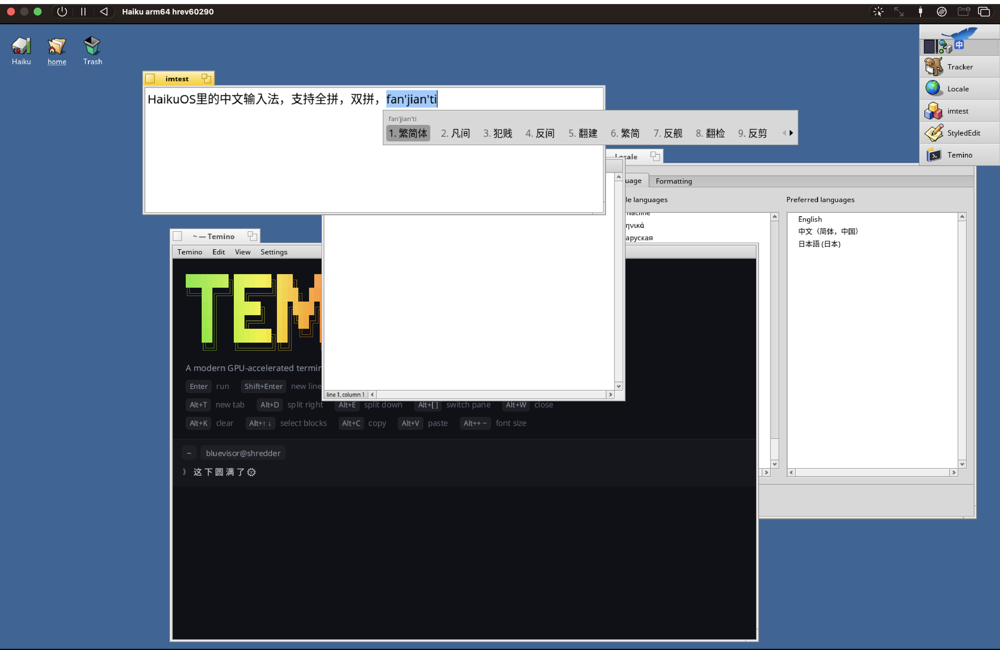

# 海酷拼音 Haiku Pinyin

[English](README.md) · [简体中文](README.zh-CN.md) · **繁體中文** ·
[下載頁](https://bluevisor.github.io/haiku-pinyin/) · [隱私](#隱私) ·
[安全性](SECURITY.md) · [參與開發](CONTRIBUTING.md)

一套給 macOS、Linux 和 Haiku 使用的拼音輸入法，手感向搜狗拼音和 macOS
內建的拼音看齊：整句輸入、簡拼（`zgr` → 中國人，`bjdx` → 北京大學）、
打到一半的音節也能出字、依照你的選擇自動調整詞頻、輸入時直接在文字中顯示拼音。
同一個引擎，三個平台各有原生的介面。可以輸出繁體或簡體。

在搭載 Apple 晶片的 Mac 上，它還能用**在本機執行的 AI 模型**幫你選字、
聯想下文；**預設不連網**，你打的字不會離開你的電腦。



| | 下載 | 形式 | 獨有功能 |
|---|---|---|---|
| **macOS** 13+ | [`.pkg` 或 `.dmg`](https://github.com/bluevisor/haiku-pinyin/releases/latest)，已簽署並經 Apple 公證 | InputMethodKit 輸入法 | 本機 AI 選字與灰色聯想（Apple 晶片）、自動更新、設定視窗 |
| **Linux** | arm64 / amd64 的 [`.deb`](https://github.com/bluevisor/haiku-pinyin/releases/latest)（Ubuntu 22.04+、Debian 12+），之後以 `apt` 簽署更新；Arch 的 `PKGBUILD`、Fedora 的 `.spec`；也可以從原始碼建置 | IBus 引擎（GNOME 等）或 Fcitx5 外掛（KDE Plasma 等） | 設定視窗（IBus、GNOME 設定；Fcitx5 也能用）、頂端列輸入法選單或 Fcitx5 設定工具 |
| **Haiku**（64 位元） | arm64 / x86_64 的 [`.hpkg`](https://github.com/bluevisor/haiku-pinyin/releases/latest)，附簽署過的檢查碼 | input_server 外掛 | Deskbar 選單和設定視窗，在 BTextView 和 Terminal 中內嵌輸入 |

## 安裝

### macOS

需要 macOS 13 或更新版本，Apple 晶片和 Intel 皆可。

1. 從 [Releases](https://github.com/bluevisor/haiku-pinyin/releases/latest)
   下載 `HaikuPinyin-<版本>.pkg`，按兩下打開。
2. 安裝程式會把它裝進 `~/Library/Input Methods`，只裝給目前的使用者，
   **不需要管理者密碼**，裝好後自動加入輸入法選單並切換過去。

也可以下載 `HaikuPinyin-<版本>.dmg`，打開後執行 **HaikuPinyin**，
它會自行安裝。如果 macOS 要求手動加入，它會提示並打開對應的位置：
系統設定 › 鍵盤 › 輸入方式 › 編輯… › **+** › 簡體中文 › **海酷拼音**。

用 Control+空白鍵 或 🌐 鍵切換到海酷拼音。安裝套件以 Developer ID
簽署並經 Apple 公證。它會**自動更新**：每天檢查一次新版本，驗證下載檔的簽章，
在 Mac 閒置時替換（在設定中關閉**自動更新**即可停用，**檢查更新…**可以立即檢查）。

**AI**（僅限 Apple 晶片）：在設定視窗按**下載模型**，從 Hugging Face
（連不上時改用 hf-mirror.com 鏡像站）下載 Qwen3-1.7B-Base 和 Qwen3.5-0.8B-Base
的 4 位元 MLX 版本，共約 1.4 GB，存到
`~/Library/Application Support/HaikuPinyin/models`，每個檔案都會驗證。
下載中斷可以接續。還沒下載模型時，打完一個詞停頓一下，
文字下方會出現一張小卡片提示一次，它不會搶走鍵盤。
模型由一個輔助程式載入（開啟 AI 時約占 1 GB 記憶體），
在一旁提供建議，打字從不等它。設定中可以分別開關 **AI 選字**和
**AI 聯想**，並選擇模型：**自動**優先使用 1.7B，在太慢的 Mac 上改用 0.8B；
放進那個資料夾的任何 MLX 模型都可以選。

**解除安裝**：在設定視窗最下方按**解除安裝…**。它會先切換到英文鍵盤（ABC 或美國），
把海酷拼音從輸入法選單中移除，等它結束後刪除 `~/Library/Input Methods` 裡的程式。
學到的詞、自訂片語、AI 模型和設定預設保留，重新安裝後一切照舊；勾選
**同時刪除我的資料**才會一併刪除 `~/Library/Application Support/HaikuPinyin`
（含模型）、設定和記錄檔。從別處連結進模型資料夾的模型不會被刪除。
輸入法選單中會馬上消失；下次登入後 macOS 會徹底忘掉它。

### Linux

兩種輸入法框架都支援：[IBus](https://github.com/ibus/ibus)（GNOME 等）和
[Fcitx5](https://github.com/fcitx/fcitx5)（KDE Plasma 等）。兩者是同一個引擎，
設定和學到的詞都存在 `~/.config/haiku-pinyin/`（`settings`、`user.dict`），
換框架也不會遺失。

**Debian、Ubuntu**（Ubuntu 22.04+、Debian 12+）：從
[Releases](https://github.com/bluevisor/haiku-pinyin/releases) 下載
`haiku-pinyin-data_<版本>_all.deb`，再依你使用的框架下載
`haiku-pinyin_<版本>_<架構>.deb`（IBus）或
`fcitx5-haiku-pinyin_<版本>_<架構>.deb`（Fcitx5），架構為 `arm64` 或 `amd64`：

```sh
# IBus
sudo apt install ./haiku-pinyin-data_*.deb ./haiku-pinyin_*.deb
haiku-pinyin-enable        # 以你自己的帳號執行：重新啟動 IBus，加入 GNOME
# Fcitx5
sudo apt install ./haiku-pinyin-data_*.deb ./fcitx5-haiku-pinyin_*.deb
fcitx5 -rd                 # 以你自己的帳號執行：重新啟動 Fcitx5
```

`haiku-pinyin-data` 會加入本專案的 apt 套件庫和發布金鑰
（`/etc/apt/sources.list.d/haiku-pinyin.sources`、
`/etc/apt/keyrings/haiku-pinyin-archive-keyring.gpg`），之後
`sudo apt update && sudo apt upgrade` 就能升級到新版本，
沒有用這把金鑰簽署的套件 apt 會拒絕安裝。套件庫就是 GitHub 上最新的 Release；
設定好之後也可以直接 `sudo apt install fcitx5-haiku-pinyin`（或 `haiku-pinyin`）。
這兩個檔案屬於設定：`apt remove` 會保留它們（仍可使用），
`apt purge haiku-pinyin-data` 才會刪除。

**Arch**：`make linux-arch` 會在 `dist/arch/` 產生可以直接送上 AUR 的
`PKGBUILD`，從 Release 的原始碼和資料封存檔建置 `ibus-haiku-pinyin`、
`fcitx5-haiku-pinyin` 和 `haiku-pinyin-data`，在旁邊執行 `makepkg -si`。
**Fedora**：`make linux-rpm` 產生 `dist/fedora/haiku-pinyin.spec`，
並在 Docker 中建置 rpm（同樣三個套件），用 `sudo dnf install` 安裝需要的。
目前還沒有上架 AUR 或 Copr。

**IBus**：`haiku-pinyin-enable`（從原始碼建置時是 `linux/enable.sh`）會重新啟動 IBus
並把**海酷拼音 Haiku Pinyin**加到 GNOME 的輸入來源（也可以在 設定 › 鍵盤 ›
輸入來源 › 中文 中手動加入），以 Super+空白鍵 切換。在 GNOME 上請不要用
`ibus restart`：常駐程式由 systemd 使用者單元管理，停了就不會再起來。
需要重新啟動時請用
`systemctl --user restart org.freedesktop.IBus.session.GNOME.service`。
不是從桌面工作階段啟動的程式需要設定 `GTK_IM_MODULE=ibus`。
設定在頂端列的輸入法選單裡，也有設定視窗：選單中的「设置…」、設定 › 鍵盤 ›
輸入來源 中海酷拼音旁的齒輪，或 `ibus-setup` 的「偏好設定」。改了立即生效，不必重新啟動。
視窗中還有詞庫的操作和**回報問題**：在 GitHub 上建立新問題，填好版本、系統和設定，
不含你輸入的文字。介面是簡體中文，系統語言不是中文時用英文。

**Fcitx5**：在 `fcitx5-configtool` 中加入**海酷拼音 Haiku Pinyin**
（KDE 上是 系統設定 › 輸入法 › 新增輸入法），以 Ctrl+空白鍵 切換。
設定在它旁邊的設定按鈕裡，和 IBus 選單中的相同。設定視窗隨 IBus 的套件安裝
（`haiku-pinyin-setup`，在引擎旁邊）；裝了的話 Fcitx5 也能用，變更立即生效。輕按 Shift 切換中/英；
有一點不同：如果輸入法群組中鍵盤配置排在它前面，Fcitx5 本身的左 Shift
（「暫時在目前和第一個輸入法之間切換」）會切到那個鍵盤配置，效果同樣是打英文；
右 Shift 和系統匣選單中的「中/英」切換的是海酷拼音自己的模式。

### Haiku

從 [Releases](https://github.com/bluevisor/haiku-pinyin/releases) 下載適合你機器的套件
（`arm64` 或 `x86_64`；32 位元 Haiku 的 gcc2 input_server 無法載入），
複製到 `~/config/packages`，然後載入：

```sh
haiku_pinyin_restart      # 重新啟動 input_server；執行時不要開著 Deskbar 選單
```

（登出再登入也可以。）候選字視窗需要一套中文字型，例如 Noto Sans CJK；
要顯示表情符號，再裝 Noto Emoji。app_server 會自動改用這兩套字型。
`.hpkg` 本身無法附帶簽章，請對照簽署過的檢查碼確認（見[驗證下載](#驗證下載)）。

## 功能

除非特別註明，以下功能三個平台都有。

- **全拼**和**雙拼**：拼音加加、小鶴、自然碼、微軟、智能ABC
- **繁體 / 簡體**輸出，打字時按 Ctrl+Shift+F 切換
- **整句輸入**，以詞對（來自 libpinyin 的二元語言模型）評分，
  並參考你前一個打的詞：`wozaixuexizhongwen` → 我在學習中文
- **AI**（macOS，Apple 晶片）：Mac 上的小型語言模型讀取游標前的文字，
  把最通順的候選字排到第一個（標示 ✦）；送出後在游標後以灰字顯示下文
  （中華人民 → 共和國），按 Tab 採用，按其他鍵照常輸入
- **聯想**：送出後接著列出常接在後面的詞，例如 祝你生日 → 快樂
- **v 模式**：`v123` → 一百二十三 / 壹佰貳拾參 / 壹佰貳拾參元整，`v1+2*3` → 7，
  `v2026.11.7` → 2026年11月7日 / 二〇二六年十一月七日，`vrq` `vsj` `vxq` →
  今天的日期、時間、星期，還有以代碼輸入的符號（`vjt` 箭頭、`vsx` 數學……）；
  雙拼時用 Shift+V
- **模糊音**：z/zh c/ch s/sh、an/ang en/eng in/ing、n/l f/h r/l，每組都能分別開關
- **中英混打**：打 `hello` 也會列出 *hello*；拼不成拼音的字母優先列出英文
- 可選的**雲端候選字**（Google 輸入工具），預設關閉，開啟後標示 ☁
- **多台電腦同步**學到的詞和自訂片語：透過你自己的同步工具同步的資料夾
  （iCloud 雲碟、Dropbox、Syncthing、Nextcloud、網路共享），沒有伺服器
- 候選字中有表情符號：太陽 → 🌞，貓 → 🐱（單色，來自 Noto Emoji）
- 全形標點（`,` → `，`，`"` → `「」` 或 `“”`），數字後保持半形
- 輕按 Shift 切換中/英；Caps Lock 開啟時直接打英文
- 候選字視窗支援滑鼠停留、捲動和翻頁箭頭；Ctrl+Delete 刪除一個學到的詞
- 空白鍵或 1–9 選字，`-` `=` 翻頁，`[` `]` 取詞的第一個 / 最後一個字（以詞定字），
  Enter 輸入字母原文，Backspace 可以撤回上一次選字
- 在支援輸入法的元件（BTextView、Terminal）中內嵌顯示拼音，其他地方直接輸入文字

## 隱私

**預設情況下，你打的字不會離開你的電腦。** 沒有帳號，沒有統計分析，
沒有遙測，也不會自動上傳當機報告。學到的詞、設定和 AI 模型都只在你的機器上。

只有以下幾件事會連網，每一件都看得到、關得掉：

- **雲端候選字**（所有平台；Linux 與 Haiku 的選單上寫作「云候选」）：
  **預設關閉**，要在設定中開啟才會啟用。只把**正在輸入、還沒選定的那段拼音**
  （例如 `woxiangchifan`）傳給 Google 輸入工具，**從不傳送已經送出的文字**、
  你選過的詞或游標周圍的內容。
- **檢查更新**（僅限 macOS 正式版）：每天一次，以及你按**檢查更新…**時，
  向 GitHub 請求
  `https://github.com/bluevisor/haiku-pinyin/releases/latest/download/latest.json`，
  只附上版本號（`HaikuPinyin/<版本>`）。在設定中關閉**自動更新**即可停止。
  自行建置的版本從不檢查。
- **下載 AI 模型**（僅限 Apple 晶片的 Mac）：只在你按**下載模型**時，
  從 Hugging Face 下載，連不上時改從 hf-mirror.com（社群維護的鏡像站，
  不屬於本專案也不屬於 Hugging Face）下載。之後 AI 完全在本機執行：
  它讀取游標前最多 64 個字，只交給同一台 Mac 上的輔助程式。
- **apt 套件庫**（Debian、Ubuntu）：輸入法本身從不連線；
  是 apt 在更新套件清單時連線（你執行 `sudo apt update`，
  或系統每天自動更新時）。刪除
  `/etc/apt/sources.list.d/haiku-pinyin.sources` 即可停止。
- **拷貝診斷資訊**（macOS）：設定 › 診斷資訊 › 拷貝，只是把報告放進剪貼簿，
  **什麼都不傳送**，要貼到哪裡由你決定。報告中沒有你打的字，也沒有學到的詞。
- **回報問題**（macOS）：設定 › 回報問題…，在本機彙整診斷資訊和近 30 天
  當機報告的摘要，讓你過目、修改，然後在瀏覽器中開啟一則填好的 GitHub 新問題。
  **它自己什麼都不傳送，也沒有伺服器**：只有你在 GitHub 上送出，內容才會公開發出。
  連結放不下時，內容會拷貝到剪貼簿，由你貼上。

**同步資料夾**（所有平台）：**預設關閉**。在設定的「同步」中選了資料夾之後，
海酷拼音會把**學到的詞**（純文字）和自訂片語寫進那裡的 `haiku-pinyin/`，
並讀取其他電腦寫入的檔案。海酷拼音本身不連網，是你的同步工具在傳送這些檔案；
**讀得到那個資料夾的人都看得到你學到的詞**，所以請選只有你能讀取的資料夾。

**永遠不會離開你電腦的**：你打的字、送出的文字、學到的詞（`user.dict`）、
你的設定（學到的詞在你開啟同步時除外）。完整說明（含程式碼位置）請見 [PRIVACY.md](PRIVACY.md)（英文）。

## 使用方式

和其他輸入法一樣切換：Haiku 上用 Deskbar 的鍵盤選單或 **Alt+空白鍵**
（如果裝了占用 Alt+空白鍵 的 [Kigo](https://github.com/bluevisor/kigo)，改用
**Win+空白鍵**）；Linux 上用 Super+空白鍵（GNOME、IBus）或 Ctrl+空白鍵（Fcitx5）；
Mac 上用 Control+空白鍵 或 🌐 鍵。

| 按鍵 | |
|---|---|
| 字母 | 拼音（或雙拼代碼）；第 1 個候選字是整句 |
| 空白鍵、1–9 | 選擇反白的 / 對應編號的候選字 |
| ← → ↑ ↓、`-` `=`、Page Up/Down | 移動反白、翻頁 |
| `[` `]` | 只取候選字的第一個 / 最後一個字（以詞定字） |
| Enter | 輸入字母原文 |
| Backspace | 刪一個字母；選過字之後，撤回那次選擇 |
| Esc | 取消 |
| Ctrl+Delete | 刪除反白的那個學到的詞 |
| Tab | （Mac，AI）採用灰色聯想；Esc 或其他鍵放棄 |
| `v` | v 模式（雙拼時用 Shift+V），見下方 |
| Shift（輕按） | 中 / 英 |
| Ctrl+Shift+F | 繁體 / 簡體，打到一半也行（Mac 上是 Control-Shift-F） |
| Caps Lock | 開啟時輸入英文 |

候選字視窗中可以點按、捲動、按翻頁箭頭。

**v 模式**：先打 `v`（雙拼中 v 是字母鍵，所以用 Shift+V），接著：

| 輸入 | 候選字 |
|---|---|
| 數字：`v123`、`v12.05` | 一百二十三、壹佰貳拾參、壹佰貳拾參元整、一二三、⑫、XII；十二點零五、壹拾貳元零伍分 |
| 算式：`v1+2*3`、`v(1+2)/4`、`v20%` | 7 和 1+2*3=7 |
| 日期：`v2026.11.7`（或用 `-` `/`） | 2026年11月7日、二〇二六年十一月七日、2026-11-07，附星期 |
| `rq` `sj` `xq` | 今天的日期、時間、星期幾 |
| `bd` `kh` `jt` `sx` `dw` `hb` | 標點、括號、箭頭、數學符號、單位、貨幣 |
| `xl` `xh` `ts` `py` `zy` | 希臘字母、序號（①⑴⒈㈠Ⅰ）、圖形與符號、帶聲調拼音、注音 |

數字後面繼續打數字，所以用字母（a b c ……）選字；代碼後面照常用數字選字。
只打 `v` 會每類各列一個。不是代碼的字母（例如 `very`）照常當作拼音和英文處理。

**設定**（Haiku 在 Deskbar 選單和其中「设置…」開啟的視窗，Linux 在設定視窗、IBus 的頂端列輸入法選單或
Fcitx5 設定工具，Mac 在設定視窗）：全拼或某種雙拼方案、雙拼中 a o e
零聲母的打法（aa oo ee、oa oo oe，或單鍵）、繁體 / 簡體、全形標點、表情符號、
中英混打、雲端候選字、三組模糊音、每頁候選字數。Haiku 上儲存在
`~/config/settings/HaikuPinyin/`，旁邊的 `user.dict` 就是學到的詞（純文字）。
Mac 上學到的詞在 `~/Library/Application Support/HaikuPinyin/user.dict`。

Mac 上輕按 Shift 切換中/英時，文字旁會顯示「中」或「英」；輸入法選單中的
**設定…**會打開設定視窗。選單和視窗跟隨系統語言：英文、簡體或繁體中文。
開啟 VoiceOver 時，會朗讀反白的候選字（以及它在本頁的位置），每個候選字都能用
VoiceOver 按下。回報錯誤時，設定中的**診斷資訊 › 拷貝**會複製版本、
Mac 機型、設定、AI 和更新的狀態以及 AI 記錄檔的結尾，不含你打的字和學到的詞。
**回報問題…**會再加上 macOS 近 30 天為輸入法或 AI 輔助程式留下的當機報告摘要，
全部讓你過目和修改，然後在瀏覽器中開啟一則填好的 GitHub 新問題；
在你於那裡送出之前，什麼都不會傳送。上次打開設定後如果又有新的當機報告，
設定頂端會出現一則提示，可以直接回報。

支援輸入法的元件（BTextView，也就是 StyledEdit 和大多數程式；Terminal；
[Temino](https://github.com/bluevisor/temino) 0.2.4+）會內嵌顯示拼音；
其他地方送出的文字會直接當作鍵入送達。

**同步**：在設定視窗的「同步」中（Mac、Linux、Haiku）選一個你自己的同步工具
已經在同步的資料夾（iCloud 雲碟、Dropbox、Syncthing、Nextcloud、網路共享），
學到的詞和自訂片語就會在幾台電腦之間保持一致。沒有伺服器。

- 資料夾裡的 `haiku-pinyin/` 中，每台電腦有自己的 `<id>.words` 和 `<id>.phrases`。
  每台只寫入自己的檔案、只讀取別人的，所以同步工具不會產生衝突副本。
- **學到的詞**按次數取較大的一個合併，不相加，所以反覆同步也不會重複計數。
  用 Ctrl+Delete 刪掉的詞，在每台電腦上都會刪掉；之後在任何一台上再用到它，
  它又會回來。
- **自訂片語**整個檔案同步：最後編輯的 `phrases.txt` 取代其他電腦的，
  被取代的那份留作 `phrases.txt.bak`。最好一次只在一台電腦上修改。
  想刪光片語就把檔案清空；直接刪掉檔案的話，會從其他電腦同步回來。
- 學到的詞儲存時（每打幾個詞）寫出自己的檔案，別台電腦的檔案有變化時讀入，
  都在獨立的執行緒上，打字從不等它。同步工具只傳了一半的檔案會被忽略，直到它完整。
- `build/hpcli sync 資料夾` 手動同步一次。

## 驗證下載

每個 Release 都有 `SHA256SUMS`，以及用本專案發布金鑰簽署的
`SHA256SUMS.asc`。公鑰是本儲存庫的 `tools/release-key.asc`，
每個 Release 中也有一份 `haiku-pinyin-release.asc`，指紋為
`1016 60C1 F375 2B00 10E7  25F6 E34D C770 E462 7F58`。在下載檔所在的資料夾中：

```sh
gpg --import haiku-pinyin-release.asc
gpg --verify SHA256SUMS.asc SHA256SUMS
sha256sum --ignore-missing -c SHA256SUMS   # Mac 上用 shasum -a 256 -c；Haiku 上用 sha256sum
```

Mac 的安裝套件另外經過 Apple 簽署和公證；Linux 套件庫由 apt 自動驗證。

## 從原始碼建置

```sh
tools/fetch_sources.sh      # rime-ice、libpinyin、OpenCC、rime-double-pinyin
make data test              # 任何平台：資料、引擎、hpcli、測試
echo zgr | build/hpcli      # 試試看
```

- **macOS**（需要 Xcode 命令列工具）：
  `tools/fetch_sources.sh && make data install-mac`，裝進 `~/Library/Input Methods`。
  `macos/install.sh --remove`（或設定中的**解除安裝…**）解除安裝。
  自行建置的版本是臨時簽署，不會自動更新。
  `NO_AI=1 macos/build.sh` 建置不含 AI 輔助程式的版本。
- **Linux**（裝好其中一個或兩個框架的開發標頭檔）：

  ```sh
  sudo apt install build-essential curl python3 libibus-1.0-dev   # IBus
  sudo apt install fcitx5-modules-dev libfcitx5core-dev \
  	libfcitx5config-dev libfcitx5utils-dev                      # Fcitx5
  # Fedora：gcc-c++ make ibus-devel fcitx5-devel；Arch：base-devel ibus fcitx5
  tools/fetch_sources.sh && make data ibus fcitx5
  sudo make install-ibus && linux/enable.sh  # 裝到 /usr，IBus 在那裡尋找引擎
  sudo make install-fcitx5 && fcitx5 -rd     # 裝到 Fcitx5 的外掛資料夾
  # 或不用 root 只裝 IBus 引擎（GNOME 或其他 systemd 使用者工作階段）：
  linux/install-user.sh                      # 裝到 ~/.local；--remove 解除安裝
  ```

- **Haiku**：`haiku/sync.sh haiku-dbg` 複製到 Haiku 機器上建置，
  在 Haiku 上 `make install`（裝進 `~/config/non-packaged`）或
  `haiku/package.sh`（產生 `.hpkg`）。input_server 不會重新載入替換過的外掛，
  每次安裝後請在沒有開著 Deskbar 選單時執行 `haiku/restart-input-server.sh`。

`make bench` 測量轉換準確率：約 300 句日常全拼、50 個簡拼和一些雙拼，
在沒有使用者詞庫的情況下輸入，首選比 `tests/bench/baseline.txt` 低一個百分點以上就失敗。
各模組說明、目錄結構和發布流程請見英文 [README](README.md)；
想參與開發請看 [CONTRIBUTING.md](CONTRIBUTING.md)。

## 資料與授權

海酷拼音以 GPL-3.0 授權發布。詞頻來自
[霧凇拼音 rime-ice](https://github.com/iDvel/rime-ice)（GPL-3.0），
簡繁轉換表來自 [OpenCC](https://github.com/BYVoid/OpenCC)（Apache-2.0），
AI 模型來自 [Qwen](https://huggingface.co/Qwen)（Apache-2.0，另外下載），
以 [MLX](https://github.com/ml-explore/mlx-swift)（MIT）執行，
詞對來自 [libpinyin](https://github.com/libpinyin/libpinyin) 的 open-gram 模型
（GPL-3.0，部分為 Apache-2.0），雙拼方案來自
[rime-double-pinyin](https://github.com/rime/rime-double-pinyin)（LGPL-3.0）的拼寫規則。
